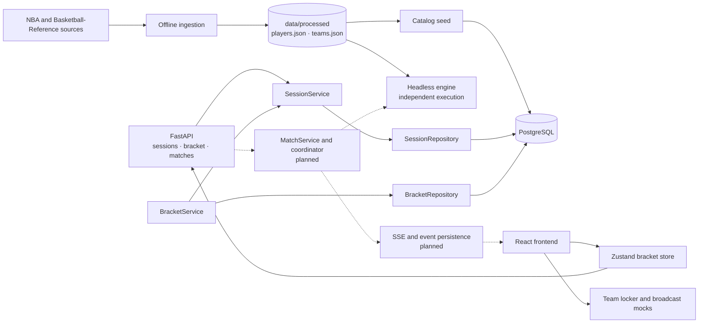
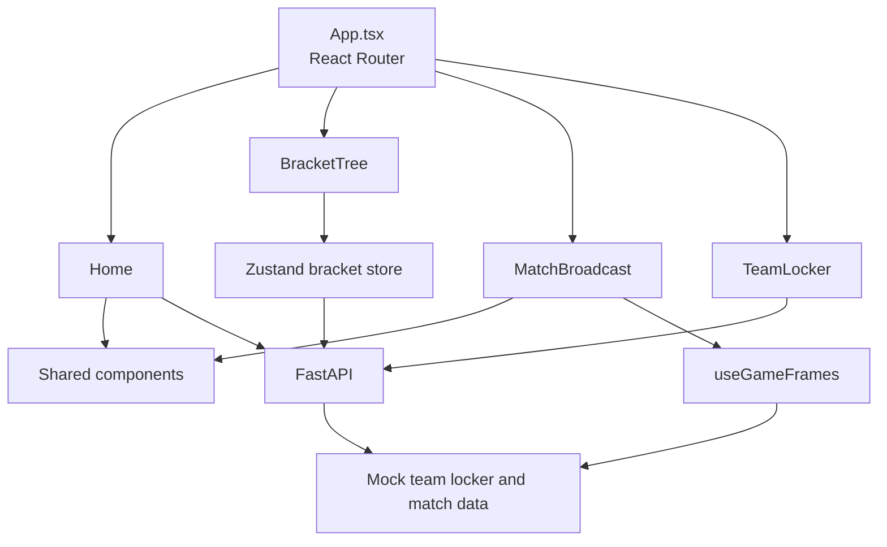
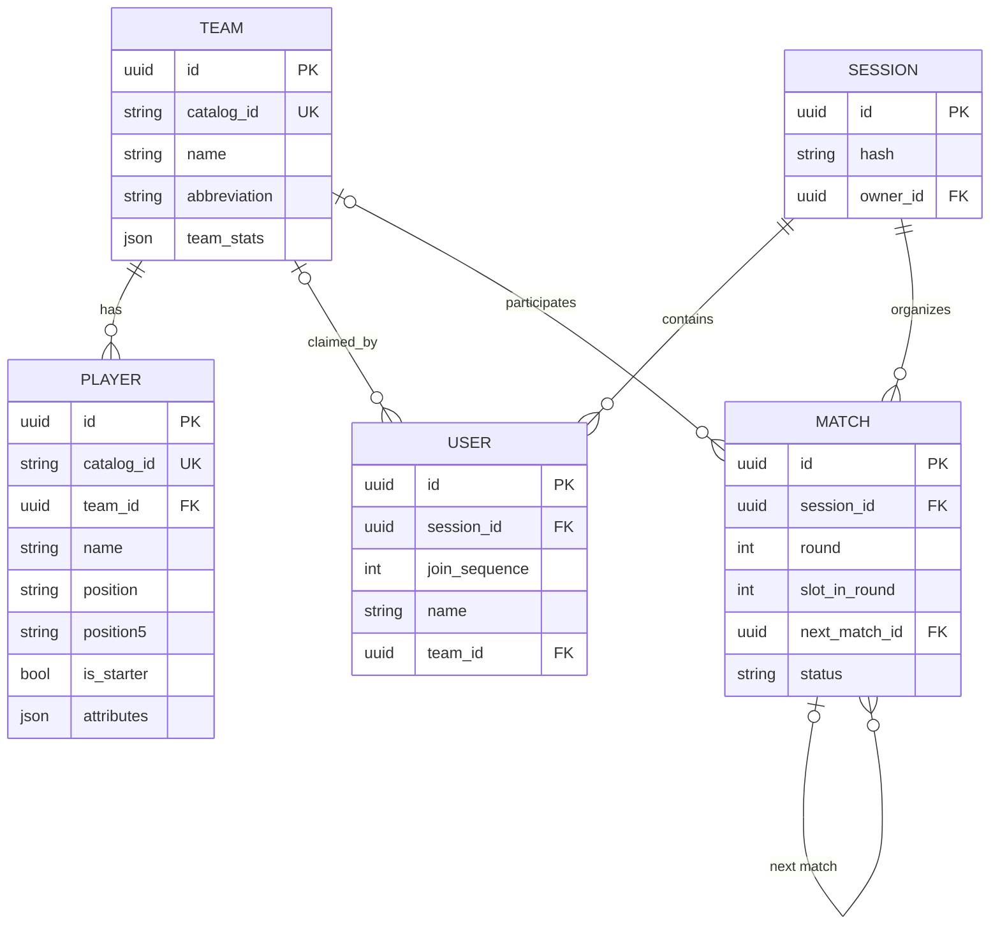
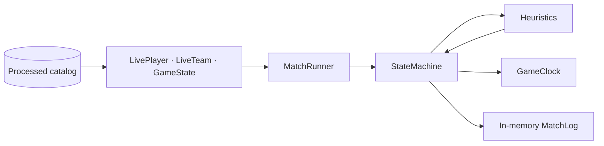
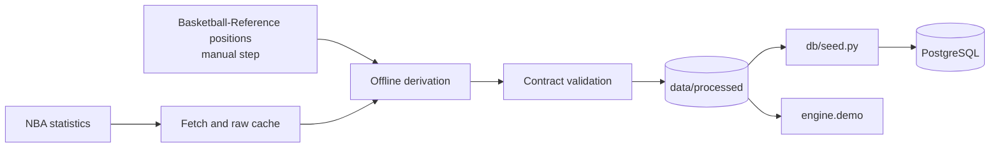

# Robô Cestinha Architecture

## Purpose and architecture status

This document describes the architecture currently implemented in the
repository and distinguishes it from planned flows. Solid arrows in the
diagrams represent existing integrations; dashed arrows represent future
integrations.

**Current status:** data ingestion prepares an offline catalog; the seed script
loads eight selected teams and their players into the database; the API manages
sessions and brackets; the bracket page reads and generates brackets through
the API; the team locker and match broadcast still use mock behavior; and the
engine runs an independent headless simulation.

## System overview



The engine reads processed data in an independent run; it is not invoked by the
API and does not query PostgreSQL during simulation. Ingestion and the seed
script are operational tasks outside request traffic.

## Frontend



- The frontend uses React, TypeScript, Vite, and React Router.
- `Home` uses the session endpoints. `BracketTree` reads bracket state and
  generation actions from a Zustand store, which calls the bracket API.
- The Team Locker endpoint still builds its response from processed JSON and
  keeps claims in memory. Match broadcast still uses mock match data.
- `useGameFrames` queues locally generated frames to animate the court. It
  does not consume SSE or replay persisted frames.
- Shared components handle presentation. Session memberships and identities
  are stored locally by the frontend.

## Backend and persistence

```mermaid
flowchart TB
    subgraph Request[Per-request composition]
        Depends[FastAPI Depends]
        Factory[ServiceFactory]
        DBSession[AsyncSession]
        Depends --> Factory
        Depends --> DBSession
        Factory --> DBSession
    end

    subgraph HTTP[Implemented FastAPI endpoints]
        Health[GET /health]
        Sessions[Session endpoints]
        GetBracket[GET /bracket/{session_hash}]
        GenerateBracket[POST /bracket/{session_hash}]
    end

    SessionService[SessionService]
    SessionRepo[SessionRepository]
    BracketService[BracketService]
    BracketRepo[BracketRepository]
    Database[(PostgreSQL)]

    Factory --> Sessions --> SessionService --> SessionRepo --> Database
    Factory --> GetBracket --> BracketService
    Factory --> GenerateBracket --> BracketService
    BracketService --> SessionService
    BracketService --> BracketRepo --> Database
    Health --> DBSession --> Database
```

- `POST /sessions` creates a session and its owner. Bracket generation is a
  separate owner action through `POST /bracket/{session_hash}`.
- `GET /bracket/{session_hash}` returns either an empty eight-team bracket
  skeleton or the saved bracket. The bracket service looks sessions up through
  `SessionService`; the session service does not depend on bracket creation.
- `api/factories.py` is the composition point: `ServiceFactory` creates
  services and repositories using a request-scoped asynchronous SQLAlchemy
  session.
- Services coordinate domain operations; repositories encapsulate queries and
  persistence. `BaseRepository` centralizes shared session and transaction
  operations.
- `core/` centralizes configuration and secrets. The intended backend
  dependency direction is API → domain → repositories → database; the engine
  and ingestion do not depend on session or HTTP concepts.

## Implemented data model

The current tables are `Team`, `Player`, `Session`, `User`, and `Match`.



`Match.next_match_id` references another row in the same table and can
represent bracket progression. The implementation does not yet have
`MatchEvent` or `MatchFrameChunk` table models; event persistence, frame
persistence, and replay remain planned.

## Patterns and responsibilities

- **Repository:** `SessionRepository` and `BracketRepository` encapsulate data
  access and share operations through `BaseRepository`.
- **Service Layer:** `SessionService` and `BracketService` coordinate domain
  workflows without directly receiving an `AsyncSession`.
- **Factory and Dependency Injection:** `ServiceFactory`, constructed by
  FastAPI per request, composes services and repositories with the database
  session.
- **State Machine:** `engine/state_machine.py` coordinates the states and
  actions of a possession.
- **Schemas as contracts:** Pydantic models describe processed data and engine
  results. They do not imply that an API or persistence flow for those results
  exists today.

## Simulation engine



The engine is headless and can be run using the demo. It uses catalog
attributes in probabilistic decisions: usage influences player selection;
turnover and steal rates influence turnovers; shooting percentages, fatigue,
and clutch influence shot outcomes. The random generator can be seeded to
reproduce a run.

The current scope is partial. The runner simulates four regulation periods;
although the clock understands overtime, tied games are not fully resolved
with overtime periods. Missed shots switch possession directly: a rebound
function exists, but the state machine does not call it. Fouls do not proceed
to free throws, and substitutions are not integrated into the loop. The
runner's result is an in-memory `MatchLog`, not persisted events or real-time
frames.

## Ingestion and catalog



The pipeline separates network fetching from offline derivation and validates
the results before writing processed files. The database seed validates those
files again, selects `bkn`, `nyk`, `bos`, `gsw`, `okc`, `lal`, `den`, and `phi`,
then creates player rows from those teams' rosters. Team statistics and player
attributes remain typed by the processed-data Pydantic schemas and are stored
as JSON columns. The team roster is represented in the database by
`Player.team_id`, rather than by a duplicate roster JSON column. The seed script
and engine demo are operational tasks; neither runs during API requests.

## Future direction

The intended flow is to connect the interface to domain endpoints, complete
the session and bracket workflow, and have a coordinator service run the
engine. Match integration may persist appropriate data and send updates to the
interface over SSE. These components and the event/frame tables should not be
described as implemented until they exist in the code.
