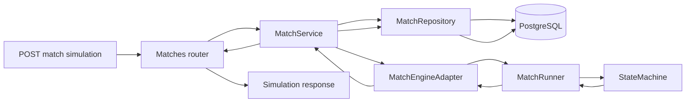

# Backend Engine Integration Plan

## 1. Purpose

This plan describes how the backend will connect a match API request to the
simulation engine and save the result.

The implementation must:

- Read the match, teams, and players from the database.
- Send the team and player data to the engine. Include player attributes.
- Run a bounded number of game transitions.
- Return one frame for the initial state and one frame after each transition.
- Record events and frames in the database.
- Save the final score and winner on the existing match row.
- Move the winner into the correct slot in the next match.
- Reject a second simulation of the same match.
- Return a recorded simulation from a GET endpoint.
- Provide a separate endpoint with a fixed mock response.

The engine must not know about FastAPI, SQLAlchemy, sessions, or HTTP. The
domain service connects the engine to the repositories. The API router calls
the domain service. Repositories own all database queries and writes.

## 2. Current code

- `backend/src/app/api/routers/matches.py` has a mock timeline route and a mock
  event stream route.
- `backend/src/app/domain/matches/service.py` contains
  `MockTimelineService`. It returns mock timeline data and does not read the
  database.
- `backend/src/app/api/factories.py` creates the mock timeline service.
- `backend/src/app/db/models/match.py` stores the match, team IDs, status,
  scores, winner, and next-match link.
- The database has `Team` and `Player` rows. `Player.attributes` stores the
  player statistics as JSON.
- `backend/src/app/engine/match_runner.py` runs a full match. It does not accept
  an iteration limit and does not return a frame after each transition.
- The engine returns a `MatchLog` with possessions and actions. It does not
  save data in the database.
- The database has no simulation, event, or frame-chunk tables.

The work must add a transition result to the engine boundary. The domain service
cannot rebuild every intermediate frame from the current final `MatchLog`.

## 3. Terms and rules

### 3.1 Iteration

One iteration is one resolved game transition. A transition is one atomic
engine action that changes the game state, such as a pass, move, shot, turnover,
or rebound.

The request field `iterations` is the maximum number of normal-play
transitions. It is not a number of seconds. The API and saved frame data must
not include a game clock or animation duration.

The result has an initial frame at iteration `0`. It then has one frame after
each completed transition. If the engine completes `N` transitions, the result
has `N + 1` frames.

### 3.2 Ball owner

Each frame has one `playerWithBallId` field. Its value is one player ID or
`null`. This field is the only ball-owner field in the frame. Do not add an
`isHoldingTheBall` flag to every player.

Use `null` while the ball is in flight. Store the ball position and optional
trajectory in the same frame. This rule prevents a frame from naming two ball
owners.

### 3.3 Iteration limit and draws

Use this rule so the match always has a winner:

1. Run normal transitions until the match ends or `iterations` is reached.
2. If the match ends with one team ahead, return that team as the winner.
3. If the iteration limit is reached with one team ahead, end the match at the
   limit and return that team as the winner. Set the termination reason to
   `iteration_limit`.
4. If the score is tied at the normal end or at the iteration limit, run
   overtime transitions until one team scores. The scoring team wins.
5. Overtime transitions can make `iterationsCompleted` larger than the
   requested `iterations`. Report the overtime count in the response.

This is an explicit exception to the normal transition limit. It is needed to
meet the rule that a match cannot end in a draw.

### 3.4 Coordinates

Return court coordinates with `x` in the range `0..94` and `y` in the range
`0..50`. Define the origin and axis directions in the API schema documentation.
The current engine uses a `10 x 5` grid. The domain adapter must convert engine
positions to the API coordinate range.

### 3.5 One simulation per match

Create one simulation record for each match. Add a database uniqueness rule on
`match_id` in the simulation table. A second request must not call the engine.
Return `409 match_already_simulated` if a simulation is running, completed, or
failed.

If a run fails, save its failed status and do not advance the bracket. Automatic
retry is not part of this plan. A later operational recovery plan can define
how to reset a failed run.

## 4. API contract

### 4.1 Start a real simulation

```http
POST /matches/{match_id}/simulation
Content-Type: application/json
```

Request:

```json
{
  "sessionHash": "RC-2026-ABC",
  "iterations": 300
}
```

The match ID is in the path. The session hash and iteration limit are in the
request body. The service must confirm that the match belongs to the session.

The route returns `201 Created` with the complete simulation result after the
engine and database work finish.

### 4.2 Read a recorded simulation

```http
GET /matches/{match_id}/timeline
```

Return the stored result. Do not call the engine from this route. Return
`404 simulation_not_found` if the match has no completed simulation.

The repository must read frame chunks by `chunk_index` and events by `sequence`.
The response schema must be the same schema used by the POST response.

### 4.3 Read a fixed mock result

```http
GET /matches/{match_id}/simulation/mock
```

This route returns a hardcoded result. It does not call the engine and does not
read or write the database. Set the response `matchId` to the ID in the path.
Use fixed team IDs, player IDs, positions, events, scores, and winner so the
result is stable between calls.

Keep `/mock` in the route name. Do not use this route to start or record a real
match. Do not connect any other module to this route in this plan. Its purpose
is to provide a stable API example and a simple route test.

## 5. Response shape

Use separate lists for frames and events. Frames are dense position data.
Events are sparse game actions.

```json
{
  "match": {
    "matchId": "match-uuid",
    "sessionId": "session-uuid",
    "status": "finished"
  },
  "simulation": {
    "status": "completed",
    "iterationsLimit": 3,
    "iterationsCompleted": 4,
    "overtimeIterations": 1,
    "terminationReason": "overtime_score"
  },
  "teams": {
    "home": { "teamId": "home-team-uuid", "name": "Home Team" },
    "away": { "teamId": "away-team-uuid", "name": "Away Team" }
  },
  "players": [
    {
      "playerId": "player-1-uuid",
      "teamId": "home-team-uuid",
      "side": "home",
      "name": "Player One",
      "position": "PG"
    },
    {
      "playerId": "player-2-uuid",
      "teamId": "away-team-uuid",
      "side": "away",
      "name": "Player Two",
      "position": "SG"
    }
  ],
  "frames": [
    {
      "iteration": 0,
      "playerWithBallId": "player-1-uuid",
      "players": [
        { "playerId": "player-1-uuid", "x": 47, "y": 25 },
        { "playerId": "player-2-uuid", "x": 63, "y": 25 }
      ],
      "ball": { "x": 47, "y": 25, "trajectory": null },
      "score": { "home": 0, "away": 0 },
      "possessionTeamId": "home-team-uuid"
    },
    {
      "iteration": 1,
      "playerWithBallId": "player-2-uuid",
      "players": [
        { "playerId": "player-1-uuid", "x": 45, "y": 25 },
        { "playerId": "player-2-uuid", "x": 60, "y": 24 }
      ],
      "ball": {
        "x": 60,
        "y": 24,
        "trajectory": {
          "type": "pass",
          "fromPosition": { "x": 45, "y": 25 },
          "toPosition": { "x": 60, "y": 24 }
        }
      },
      "score": { "home": 0, "away": 0 },
      "possessionTeamId": "home-team-uuid"
    },
    {
      "iteration": 2,
      "playerWithBallId": null,
      "players": [
        { "playerId": "player-1-uuid", "x": 44, "y": 25 },
        { "playerId": "player-2-uuid", "x": 58, "y": 22 }
      ],
      "ball": {
        "x": 75,
        "y": 24,
        "trajectory": {
          "type": "shot",
          "fromPosition": { "x": 58, "y": 22 },
          "toPosition": { "x": 94, "y": 25 }
        }
      },
      "score": { "home": 0, "away": 0 },
      "possessionTeamId": "home-team-uuid"
    },
    {
      "iteration": 3,
      "playerWithBallId": "player-3-uuid",
      "players": [
        { "playerId": "player-1-uuid", "x": 44, "y": 25 },
        { "playerId": "player-2-uuid", "x": 58, "y": 22 }
      ],
      "ball": { "x": 94, "y": 25, "trajectory": null },
      "score": { "home": 2, "away": 0 },
      "possessionTeamId": "away-team-uuid"
    }
  ],
  "events": [
    {
      "sequence": 1,
      "iteration": 0,
      "type": "game_started",
      "teamId": "home-team-uuid",
      "playerId": "player-1-uuid",
      "targetPlayerId": null,
      "data": {}
    },
    {
      "sequence": 2,
      "iteration": 1,
      "type": "pass_completed",
      "teamId": "home-team-uuid",
      "playerId": "player-1-uuid",
      "targetPlayerId": "player-2-uuid",
      "data": {}
    },
    {
      "sequence": 3,
      "iteration": 2,
      "type": "shot_attempted",
      "teamId": "home-team-uuid",
      "playerId": "player-2-uuid",
      "targetPlayerId": null,
      "data": { "shotValue": 2 }
    },
    {
      "sequence": 4,
      "iteration": 3,
      "type": "shot_made",
      "teamId": "home-team-uuid",
      "playerId": "player-2-uuid",
      "targetPlayerId": null,
      "data": {
        "pointsScored": 2,
        "scoreAfter": { "home": 2, "away": 0 }
      }
    },
    {
      "sequence": 5,
      "iteration": 3,
      "type": "possession_changed",
      "teamId": "away-team-uuid",
      "playerId": null,
      "targetPlayerId": null,
      "data": { "previousTeamId": "home-team-uuid" }
    },
    {
      "sequence": 6,
      "iteration": 4,
      "type": "game_finished",
      "teamId": "home-team-uuid",
      "playerId": null,
      "targetPlayerId": null,
      "data": { "winnerTeamId": "home-team-uuid" }
    }
  ],
  "summary": {
    "homeScore": 2,
    "awayScore": 0,
    "winnerTeamId": "home-team-uuid"
  }
}
```

The example shows two players to keep it short. Each real frame must include all
ten on-court players. Do not add game-clock, elapsed-seconds, or animation-time
fields.

Event types must include at least:

- `game_started`
- `pass_completed`
- `pass_intercepted`
- `shot_attempted`
- `shot_made`
- `shot_missed`
- `free_throw_made`
- `turnover`
- `rebound`
- `foul`
- `possession_changed`
- `overtime_started`
- `game_finished`

`shot_made` and `free_throw_made` must include `pointsScored` and `scoreAfter`.
For example, a one-point free throw uses `pointsScored: 1`. Multiple events may
use the same iteration. `sequence` gives their exact order.

## 6. Data flow

### 6.1 Component diagram



### 6.2 Request sequence

```mermaid
sequenceDiagram
    participant API as Matches API
    participant Service as MatchService
    participant Repo as MatchRepository
    participant DB as Database
    participant Adapter as MatchEngineAdapter
    participant Engine as MatchRunner

    API->>Service: simulate_match(sessionHash, matchId, iterations)
    Service->>Repo: get_match_context(sessionHash, matchId)
    Repo->>DB: Read match, teams, and all related players
    DB-->>Repo: Match context and player attributes
    Repo-->>Service: Match context
    Service->>Repo: reserve_simulation(matchId, iterations)
    Repo->>DB: Check ready status; create unique running simulation
    DB-->>Repo: Simulation reservation
    Repo-->>Service: Simulation record
    Service->>Adapter: run(context, iterations)
    Adapter->>Engine: run_match(engine teams, iterations)
    Engine-->>Adapter: Frames, events, score, and winner
    Adapter-->>Service: Database-ID result
    Service->>Repo: complete_simulation(simulationId, result)
    Repo->>DB: Save events and frame chunks
    Repo->>DB: Save score, winner, and finished status
    Repo->>DB: Set winner in next match and unlock it when ready
    DB-->>Repo: Commit all result changes
    Repo-->>Service: Completed result
    Service-->>API: Result DTO
    API-->>API: Validate API response schema
```

The mock endpoint uses a shorter path. It calls `MockSimulationService` and
returns its fixed result. It does not call the repository or engine.

## 7. Backend class and method stubs

These stubs show responsibility and call order. They do not contain
implementations.

### 7.1 API schemas

```python
# backend/src/app/api/schemas/match_simulation.py

class SimulateMatchRequest(BaseModel):
    sessionHash: str
    iterations: int


class SimulationFrameSchema(BaseModel):
    iteration: int
    playerWithBallId: UUID | None
    players: list[PlayerPositionSchema]
    ball: BallSchema
    score: ScoreSchema
    possessionTeamId: UUID | None


class SimulationEventSchema(BaseModel):
    sequence: int
    iteration: int
    type: str
    teamId: UUID | None
    playerId: UUID | None
    targetPlayerId: UUID | None
    data: dict[str, object]


class MatchSimulationResponse(BaseModel):
    match: MatchSummarySchema
    simulation: SimulationSummarySchema
    teams: TeamPairSchema
    players: list[PlayerMetadataSchema]
    frames: list[SimulationFrameSchema]
    events: list[SimulationEventSchema]
    summary: FinalMatchSummarySchema
```

Validate `iterations >= 1` and apply a configured upper limit. API schemas must
stay separate from database models and engine schemas.

### 7.2 Router and factory

```python
# backend/src/app/api/routers/matches.py

@router.post("/{match_id}/simulation", response_model=MatchSimulationResponse)
async def simulate_match(match_id, request, factory) -> MatchSimulationResponse:
    ...


@router.get("/{match_id}/timeline", response_model=MatchSimulationResponse)
async def get_recorded_match(match_id, factory) -> MatchSimulationResponse:
    ...


@router.get(
    "/{match_id}/simulation/mock",
    response_model=MatchSimulationResponse,
)
async def get_mock_simulation(match_id, factory) -> MatchSimulationResponse:
    ...
```

```python
# backend/src/app/api/factories.py

class ServiceFactory:
    def match_service(self) -> MatchService:
        ...

    def mock_simulation_service(self) -> MockSimulationService:
        ...
```

The router validates the request, calls one service method, and maps known
domain errors to HTTP errors. The router must not query the database or call
the engine directly.

### 7.3 Domain service and engine adapter

```python
# backend/src/app/domain/matches/service.py

class MatchService:
    def __init__(self, repository, engine_adapter) -> None:
        ...

    async def simulate_match(
        self,
        session_hash: str,
        match_id: UUID,
        iterations: int,
    ) -> MatchSimulationResult:
        ...

    async def get_recorded_match(
        self,
        match_id: UUID,
    ) -> MatchSimulationResult:
        ...
```

```python
# backend/src/app/domain/matches/engine_adapter.py

class MatchEngineAdapter:
    def build_engine_teams(self, context: MatchContext) -> EngineMatchInput:
        ...

    def run(
        self,
        context: MatchContext,
        iterations: int,
    ) -> MatchSimulationResult:
        ...

    def map_engine_ids_to_database_ids(
        self,
        result: EngineSimulationResult,
        id_map: EngineIdMap,
    ) -> MatchSimulationResult:
        ...
```

The service owns the workflow. The adapter maps database records to the
engine's input and maps result IDs back to database IDs. The service must pass
all players for both teams and all stored player attributes. It must not change
the meaning of any player attribute.

The current engine uses catalog-style IDs. Build an explicit map from each
engine team/player ID to its database UUID. Return database UUIDs in API data
and persisted event references.

The engine call is synchronous. Run it outside the async event loop, for
example with `asyncio.to_thread`. Do not hold a database transaction open while
the engine runs.

### 7.4 Repository

```python
# backend/src/app/domain/matches/repository.py

class MatchRepository(BaseRepository):
    async def get_match_context(
        self,
        session_hash: str,
        match_id: UUID,
    ) -> MatchContext:
        ...

    async def reserve_simulation(
        self,
        match_id: UUID,
        iterations: int,
    ) -> MatchSimulation:
        ...

    async def complete_simulation(
        self,
        simulation_id: UUID,
        result: MatchSimulationResult,
    ) -> None:
        ...

    async def fail_simulation(
        self,
        simulation_id: UUID,
        error_code: str,
    ) -> None:
        ...

    async def get_recorded_simulation(
        self,
        match_id: UUID,
    ) -> MatchSimulationResult | None:
        ...
```

`get_match_context` must verify all of these rules:

- The session hash exists.
- The match exists in that session.
- Both team IDs are set.
- Both teams and their players exist.
- The match is ready and has no simulation record.

`reserve_simulation` must make the one-run check safe for concurrent requests.
Use a unique database constraint and a transaction. Do not rely only on a
Python status check.

`complete_simulation` must use one database transaction. It must save the
events and frame chunks, update the match score/status/winner, and update the
next match. If one write fails, roll back all completion writes.

### 7.5 Engine result types and runner

```python
# backend/src/app/engine/schemas.py

class SimulationFrame(BaseModel):
    iteration: int
    player_with_ball_id: str | None
    players: list[PlayerPosition]
    ball: BallState
    score: Score
    possession_team_id: str | None


class SimulationEvent(BaseModel):
    sequence: int
    iteration: int
    type: str
    team_id: str | None
    player_id: str | None
    target_player_id: str | None
    data: dict[str, object]


class EngineSimulationResult(BaseModel):
    frames: list[SimulationFrame]
    events: list[SimulationEvent]
    iterations_completed: int
    overtime_iterations: int
    home_score: int
    away_score: int
    winner_team_id: str
    termination_reason: str
```

```python
# backend/src/app/engine/match_runner.py

class MatchRunner:
    def run_match(self, max_iterations: int) -> EngineSimulationResult:
        ...

    def _capture_frame(self, iteration: int) -> SimulationFrame:
        ...

    def _record_transition_events(
        self,
        iteration: int,
        transition: TransitionResult,
    ) -> list[SimulationEvent]:
        ...

    def _resolve_overtime_until_score(self) -> None:
        ...
```

```python
# backend/src/app/engine/state_machine.py

class StateMachine:
    def resolve_next_transition(self, state: GameState) -> TransitionResult:
        ...
```

Refactor the runner so it captures a frame after each transition. The state
machine must expose one transition at a time. The current
`resolve_possession()` call can process several actions before it returns. That
does not provide enough states for this contract.

### 7.6 Mock service

```python
# backend/src/app/domain/matches/mock_service.py

class MockSimulationService:
    def get_mock_simulation(self, match_id: UUID) -> MatchSimulationResult:
        ...
```

Store a fixed fixture in this service or in a small fixture module. Include an
initial frame, at least three transitions, a pass, a missed or made shot, a
scoring event, a possession change, and a finished result. Include
`playerWithBallId` in every frame. Return the same result on every call, except
that `matchId` matches the path value.

### 7.7 Database models

```python
# backend/src/app/db/models/match_simulation.py

class MatchSimulation(Base):
    id: UUID
    match_id: UUID  # unique foreign key to matches.id
    status: str  # running | completed | failed
    iterations_limit: int
    iterations_completed: int
    overtime_iterations: int
    termination_reason: str | None
    random_seed: int | None
    engine_version: str | None
    started_at: datetime
    completed_at: datetime | None
```

```python
# backend/src/app/db/models/match_event.py

class MatchEvent(Base):
    id: UUID
    simulation_id: UUID
    sequence: int
    iteration: int
    type: str
    team_id: UUID | None
    player_id: UUID | None
    target_player_id: UUID | None
    payload: dict
```

Add a unique constraint on `(simulation_id, sequence)`.

```python
# backend/src/app/db/models/match_frame_chunk.py

class MatchFrameChunk(Base):
    id: UUID
    simulation_id: UUID
    chunk_index: int
    first_iteration: int
    frame_count: int
    frames: list[dict]
```

Add a unique constraint on `(simulation_id, chunk_index)`. Use a fixed initial
chunk size of 100 frames. Keep the chunk size in one named constant. Do not
create one database row for every player position.

Update `Match` with a relationship to `MatchSimulation`. The `matches` table
continues to store the bracket status, final scores, and winner. Keep
simulation status on `MatchSimulation`.

## 8. Exact implementation order

### Step 1: Define and test the contract

1. Add `api/schemas/match_simulation.py`.
2. Define all response fields in this plan. Do not add time or clock fields.
3. Add schema validation for positive iteration limits, coordinate bounds,
   ordered frame iterations, unique player IDs per frame, and one
   `playerWithBallId` value per frame.
4. Add `GET /matches/{match_id}/simulation/mock`.
5. Add `MockSimulationService` with a fixed result.
6. Test that the mock route returns the response schema and does not call the
   engine or database.

### Step 2: Add persistence

1. Add `MatchSimulation`, `MatchEvent`, and `MatchFrameChunk` models.
2. Update model exports and the `Match` relationship.
3. Add an Alembic migration. Include all foreign keys, indexes, and unique
   constraints in the migration.
4. Add repository queries for the match context and saved simulation.
5. Add repository methods to reserve and complete a simulation.
6. Test match/session validation, one-run enforcement, event ordering, chunk
   ordering, rollback, and bracket advancement.

### Step 3: Add the engine result boundary

1. Add engine frame, event, transition, and result schemas.
2. Add `StateMachine.resolve_next_transition()`.
3. Update `MatchRunner.run_match(max_iterations)` to call one transition at a
   time.
4. Capture the initial frame before the first transition.
5. Capture one frame after every transition.
6. Add events with a global sequence number and the matching iteration.
7. Add overtime logic. Continue until a team scores when the match is tied.
8. Ensure `player_with_ball_id` is one ID or `None` in every frame.
9. Test frame count, event iteration links, scoring, iteration-limit endings,
   and tie resolution.

Do not change probability rules as part of this integration work. The adapter
must pass stored player attributes to the engine unchanged.

### Step 4: Connect the domain service

1. Add `MatchEngineAdapter`.
2. Load both team records and all their player records through the repository.
3. Validate player attributes against the engine input schema.
4. Build an explicit engine-ID-to-database-ID map.
5. Reserve the simulation before calling the engine.
6. Run the synchronous engine call outside the async event loop.
7. Convert the engine result to the domain result type.
8. Call the repository completion method.
9. On an exception, mark the simulation and match as failed. Do not advance the
   bracket.
10. Add `MatchService` to `ServiceFactory`.

Domain services must not import FastAPI or API Pydantic schemas. Repositories
must own all SQLAlchemy queries and writes.

### Step 5: Add real start and read routes

1. Add `POST /matches/{match_id}/simulation` with `sessionHash` and
   `iterations` in the request body.
2. Map domain errors to stable API errors:
   - `404 match_or_session_not_found`
   - `409 match_not_ready`
   - `409 match_already_simulated`
   - `422 invalid_iterations`
   - `500 simulation_failed`
3. Return the completed result with `201 Created`.
4. Replace the mock implementation of `GET /matches/{match_id}/timeline` with
   a repository read. Do not call the engine from GET.
5. Keep the separate `/simulation/mock` route fixed and clearly named.

### Step 6: Verify bracket completion

In the completion transaction:

1. Set the final home and away scores on `Match`.
2. Set `winner_team_id` and `Match.status = "finished"`.
3. Read `next_match_id` and `next_match_slot`.
4. Write the winner into the selected home or away slot.
5. Set the next match to `ready` only when both team slots are filled.
6. Commit the event rows, frame chunks, match result, and next-match update
   together.

If any step fails, roll back the completion transaction. Do not save a finished
match without its bracket update.

## 9. Target files

| File | Action | Purpose |
|---|---|---|
| `backend/src/app/api/routers/matches.py` | Change | Add mock, start, and recorded-result routes. Keep routes thin. |
| `backend/src/app/api/schemas/match_simulation.py` | Add | Define request and response contracts. |
| `backend/src/app/api/schemas/__init__.py` | Change | Export the new API schemas if this package uses exports. |
| `backend/src/app/api/factories.py` | Change | Build request-scoped match and mock services. |
| `backend/src/app/domain/matches/service.py` | Change | Add the real match workflow. Replace or separate the current mock timeline service. |
| `backend/src/app/domain/matches/repository.py` | Add | Read match context and persist/retrieve simulation data. |
| `backend/src/app/domain/matches/engine_adapter.py` | Add | Map database records and IDs to and from engine types. |
| `backend/src/app/domain/matches/types.py` | Add | Define domain result and match-context data types without FastAPI or Pydantic. |
| `backend/src/app/domain/matches/mock_service.py` | Add | Return the fixed mock result for the mock route. |
| `backend/src/app/db/models/match_simulation.py` | Add | Store one simulation record per match. |
| `backend/src/app/db/models/match_event.py` | Add | Store ordered semantic events. |
| `backend/src/app/db/models/match_frame_chunk.py` | Add | Store batches of ordered frames. |
| `backend/src/app/db/models/match.py` | Change | Add the simulation relationship. Keep bracket result fields here. |
| `backend/src/app/db/models/__init__.py` | Change | Export the new ORM models for metadata and migrations. |
| `backend/alembic/versions/0004_match_simulation_results.py` | Add | Create the simulation, event, and frame-chunk tables and constraints. Use the next revision ID if migrations change before implementation. |
| `backend/src/app/engine/schemas.py` | Change | Add transition, frame, event, and simulation-result types. |
| `backend/src/app/engine/state_machine.py` | Change | Expose one resolved transition at a time. |
| `backend/src/app/engine/match_runner.py` | Change | Accept the iteration limit and capture frames/events. Add tie resolution. |
| `backend/tests/api/test_matches.py` | Change | Test mock, start, read, status codes, and duplicate requests. |
| `backend/tests/domain/test_match_service.py` | Add | Test orchestration, engine input, ID mapping, and errors. |
| `backend/tests/domain/test_match_repository.py` | Add | Test queries, constraints, persistence, and bracket transaction. |
| `backend/tests/engine/test_match_runner.py` | Add | Test transitions, frames, events, score, iteration limit, and overtime. |

Do not change unrelated API routers or database models. Do not add a streaming
simulation route as part of this work.

## 10. Completion checks

The implementation is complete when all checks below pass:

- The mock endpoint returns a stable response with no database or engine call.
- The real POST checks session ownership and match readiness.
- The engine receives both teams and all related players with their attributes.
- A result has one initial frame and one frame per completed transition.
- A frame has exactly one scalar `playerWithBallId` value, or `null`.
- Events have a unique sequence and point to a valid iteration.
- A tied match continues until a scoring team exists.
- No game-clock or animation-time value appears in the API response or frame
  storage.
- A duplicate POST does not run the engine a second time.
- The GET route returns stored data without running the engine.
- Events, frame chunks, match result, and bracket advancement commit together.
- A failed run does not write a winner or advance the bracket.
- All new tables have an Alembic migration.
- Domain, repository, router, and engine tests pass.

For every new domain, model, and route method, follow
`backend/AGENTS.md`: add the required Google-style docstring, keep database
access in repositories, keep routers thin, and keep API schemas separate from
ORM models.
